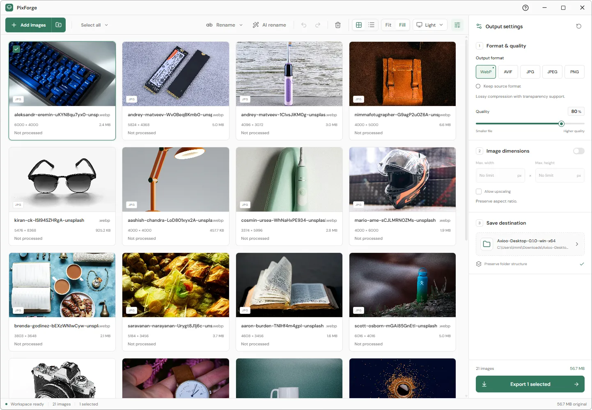

  

<h1 align="center">PixForge</h1>

Convert, compress, resize, and rename image folders on your computer.

  <a href="https://github.com/immiProgrammer/pix-forge/releases/latest">Download for Windows</a>
  &nbsp; &middot; &nbsp;
  <a href="#get-started">Get started</a>
  &nbsp; &middot; &nbsp;
  <a href="docs/GUIDE.md">Detailed guide</a>

<picture>
  <source media="(prefers-color-scheme: dark)" srcset="apps/web/public/screenshots/dark-fill.webp" />
  
</picture>

PixForge helps you prepare product photos, website images, portfolios, and other
image collections. Add your images, choose how they should look and what they
should be called, then check the results before saving them.

Your original files stay unchanged. Images are processed on your computer without
uploads or an account.

## Download

Open [Releases](https://github.com/immiProgrammer/pix-forge/releases/latest) and
download the **Windows EXE installer**, then open it to install PixForge.
An **MSI installer** is also provided for managed installations.

If no installer is listed, a release has not finished publishing yet. Releases in
a private repository are available only to people with repository access.

## Get started

1. **Add your images.** Drop files or folders into PixForge, or use **Add images**
   and **Add folder**. You can add more without starting over.
2. **Choose the output.** Pick a format, adjust quality, and optionally set a
   maximum width or height. Images keep their proportions.
3. **Rename if needed.** Use a folder name, a custom name with numbering, or edit
   filenames individually. Undo and redo are available for name changes.
4. **Compare the result.** Double-click an image to see the original and processed
   version side by side or with a slider. Zoom in and check the actual file size.
5. **Export.** Choose a destination folder and export all images or just your
   selection. PixForge keeps the imported folder structure.

## What you can do

| Task                   | How PixForge helps                                                                               |
| ---------------------- | ------------------------------------------------------------------------------------------------ |
| Convert images         | Save as WebP, AVIF, JPG, JPEG, or PNG, or keep the source format.                                |
| Reduce file sizes      | Adjust quality and compression, then inspect the result.                                         |
| Resize a collection    | Set maximum dimensions without stretching images.                                                |
| Clean up filenames     | Rename in batches, add numbering, or make names lowercase with hyphens between words.            |
| Organize large folders | Switch between grid and list views; select with clicks, keyboard shortcuts, or a drag rectangle. |
| Check your savings     | See original and output sizes, with reduction percentages by image, folder, and export.          |
| Work comfortably       | Choose Light, Dark, or System theme and Fit or Fill for image cards.                             |

For example, `IMG_4821.jpg` can become `linen-shirt-001.webp`.

## Export performance

Choose **Low memory**, **Balanced**, or **Maximum speed** in the settings panel.
PixForge adjusts parallel processing to your CPU, available RAM, and image sizes.
Leave the worker and RAM limits blank for automatic settings.

## Optional AI renaming

Use **AI rename** to copy a naming prompt into an AI tool of your choice. Paste its
response back into PixForge, review the proposed names, and apply them together.
The prompt can preserve useful details such as sizes and colors while removing
words like WhatsApp or Screenshot. PixForge does not upload your images to AI.

See the [AI renaming guide](docs/AI-RENAME.md) for the full steps.

## A few things to know

- PixForge starts with **still images**. Animated images are detected and reported
  because animation preservation is not supported.
- Selecting images alone does not process them. Change a setting, open comparison,
  or use the small processing button on an image to generate a result.
- Existing destination files have clear choices: **Add suffix**, **Skip**, or
  **Replace**. Adding a suffix keeps both files.
- Cancelling an export keeps completed files. The result report lets you retry
  failed images.

## Technical guides

You do not need development tools to use an installer. For building or contributing:

- [Build on Windows](docs/WINDOWS-BUILD.md)
- [Detailed features and development commands](docs/GUIDE.md)
- [Publish installers](docs/RELEASING.md)
- [Website setup](apps/web/README.md) and [Dokploy deployment](docs/DOKPLOY.md)
- [Processing performance](docs/PERFORMANCE.md)
